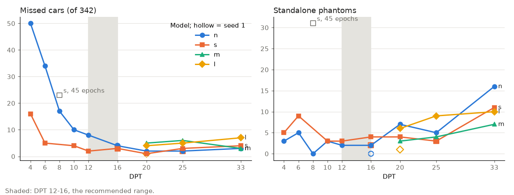
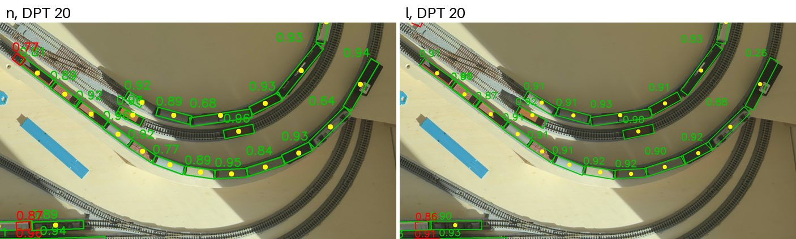
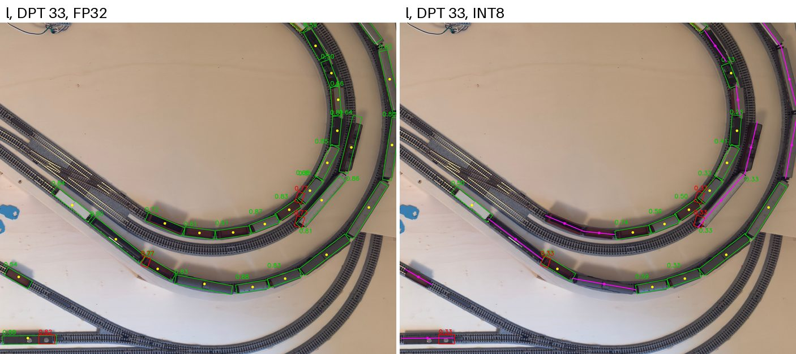
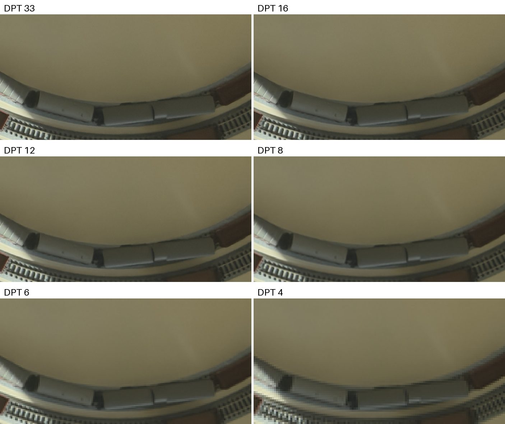
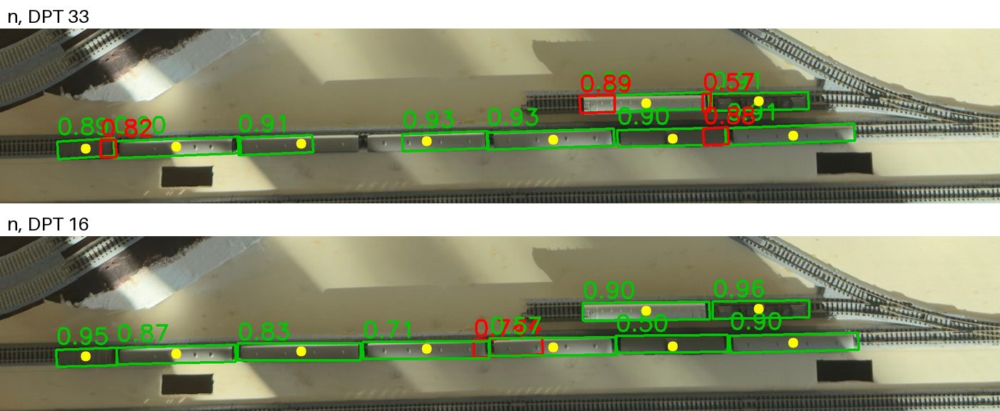
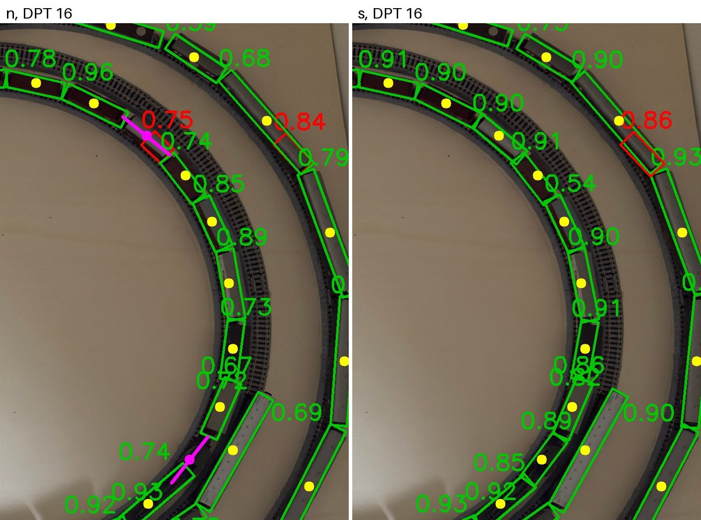
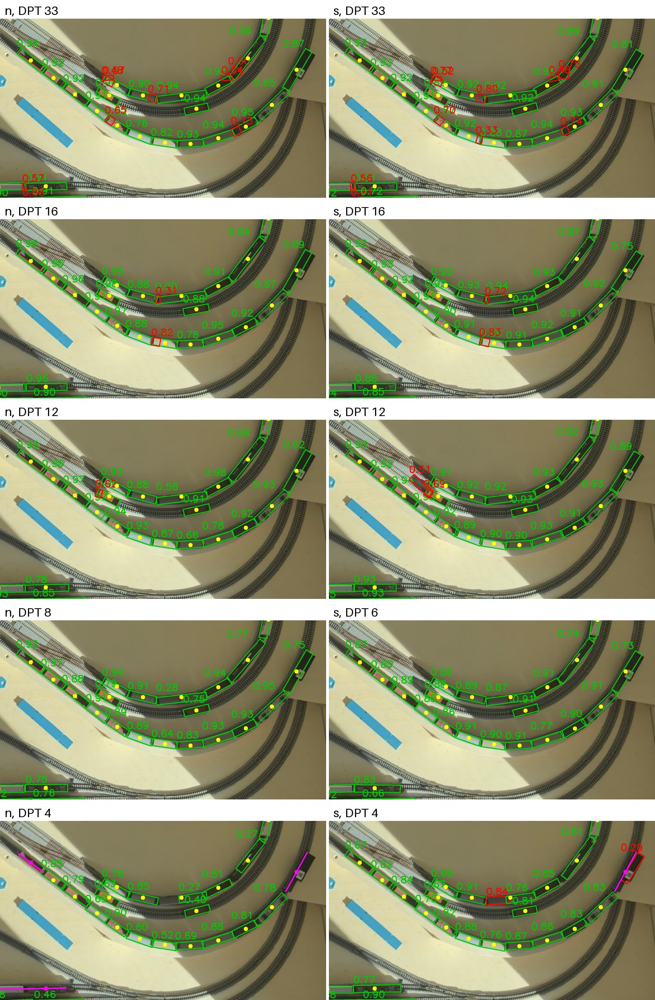

# Model size, DPT and hardware: what the experiments show

Written 2026-11-02. It summarises the accuracy experiments of
[#37](https://github.com/rails49/detector/issues/37) and [#25](https://github.com/rails49/detector/issues/25)
and the hardware research of [#31](https://github.com/rails49/detector/issues/31). It ranks
the YOLO model sizes, the DPT and the hardware as promising, possible or not worth it, and
sizes the detector to run slowly beside the 10 Hz per-spot classifier
([rails49/occupancy#272](https://github.com/rails49/occupancy/issues/272)).

Evidence tags: **M** measured here, **P** published figure, **E** estimate or arithmetic.

## What we expected, what the data shows

| | Expected (2026-08 to 10) | Measured or derived now |
|---|---|---|
| Resolution | DPT 20 minimum (`SPEC.md`), DPT 33 for accuracy | DPT 12–16 is as accurate as DPT 20–33, with fewer phantoms (M) |
| Model | Start from l or x for accuracy | n and s are as accurate as m and l; l and m fail in INT8 (M) |
| Compute per refresh, whole 2×1 m layout | l at DPT 33: 14.4 TFLOP, beyond any home hardware | n at DPT 16: 0.14 TFLOP, about 100× less (E) |
| Hardware | RTX-class PC or nothing | 1.5 Hz fits a phone's or a Mac's neural engine (E) |
| Rate | Detector at 1.5 Hz in stations | Classifier at 10 Hz for sensors, detector at 0.3–1.5 Hz for positions and counts |

The question has moved from "can any home hardware run the detector" to "how slow and how
much of the layout can the detector be, beside a 10 Hz classifier". At 0.3–1.5 Hz every
native device fits, and the browser fits part of the layout.

## How far the data goes

- One layout, three ceiling archives from one iPhone 16 Pro Max. 32 training frames, 11
  held-out frames with 342 cars. Many held-out frames repeat a car arrangement under other
  light.
- Each model fine-tuned once from DOTA weights, 45 epochs (135 for n at DPT 4–10 and s at
  DPT 4–6). Four runs have a second seed: n16, s16, s25, l20. Seed repeats move misses by
  1–3, so differences of 3 or fewer are noise.
- Scored at confidence 0.25 by car midpoint: a miss is a car whose midpoint no box contains.
  A phantom is a box that contains no midpoint. A **standalone** phantom is not at least
  half inside a found car; the rest are fragments on cars already found and change no sensor
  state.
- Lower DPT is simulated by scaling the 48 MP stills down. No frame was captured at DPT 12–16.
- Nothing here measures the L1 contract (false clear < 0.1 % per sensor). 4 misses in 342
  cars is 1.2 % per car.

## The map

### Model × DPT

FP32 misses / standalone phantoms on 342 cars, seed 0, with the tier: promising, possible
or no (not worth it).

| DPT | n | s | m | l |
|---|---|---|---|---|
| 33 | no 3 / 16 | no 4 / 11 | no 3 / 7 | no 7 / 10 |
| 25 | possible 2 / 5 | possible 3 / 3 | no 6 / 4 | no 5 / 9 |
| 20 | possible 2 / 7 | possible 1 / 4 | no 5 / 3 | no 4 / 6 |
| 16 | **promising 4 / 2** | **promising 3 / 4** | – | – |
| 12 | possible 8 / 2 | **promising 2 / 3** | – | – |
| 10 | no 10 / 3 | possible 4 / 3 | – | – |
| 8 | no 17 / 0 | no 23 / 31 (45 epochs) | – | – |
| 6 | no 34 / 5 | no 5 / 9, 4 merges | – | – |
| 4 | no 50 / 3 | no 16 / 5 | – | – |

*[`plot.py`](model-dpt-hardware/plot.py) draws this from the #37 numbers.*

**Best choice: n at DPT 16.** Its 4 misses (both seeds) are within noise of the best, it has
the fewest standalone phantoms (2 and 0), it holds in INT8 at a lower threshold, and it costs
little more than DPT 12 (137 against 118 GFLOP per refresh). **Good compromise: s at DPT 12–16** if
n's misses turn out too high on a larger corpus: 2–3 misses, 3.6–3.8× n's compute.

### Hardware for n at DPT 16

Maximum update rate for the whole 2×1 m layout, from published benchmarks of similar
chips ([§ Throughput per device](#throughput-per-device)). 1.5 Hz needs 0.21 TFLOP/s, 5 Hz
0.69 and 10 Hz 1.37.

| Tier | Setup | Camera, DPT | Max rate, n at DPT 16 |
|---|---|---|---|
| promising | A. iPhone 16 Pro Max, native Core ML (owned) | its own 4K video, DPT 16 | 4–11 Hz on iPhone 17 Pro figures (P); measure in [#42](https://github.com/rails49/detector/issues/42) |
| promising | B. Mac mini M6 ($899); M2 Max owned as stand-in | 4K USB camera, DPT 14 | 3–10 Hz on M4 figures, Core ML to Core AI (P); measure in [#43](https://github.com/rails49/detector/issues/43) |
| possible | C. PC with RTX 5060 (~$450 card plus host), TensorRT | USB3 camera | well above 10 Hz; l alone would run 8–13 Hz (E) |
| possible | Jetson Orin Nano Super ($399), TensorRT FP16 | Pi HQ or USB camera | 9 Hz (P) |
| possible | D. Used Snapdragon 8 Elite phone ($540–700), QNN | its own video | 8 Hz (P) |
| possible | E. Pi 5 + Hailo-8 or Hailo-10H ($295–375), HailoRT | one Pi HQ, DPT 17, 10 fps | 7–14 Hz (E), only if YOLO26-OBB compiles |
| possible | Browser, WASM, beside the classifier | 4K video, DPT 16 | 0.4 Hz (M); 1–2 Hz on 2–4 tiles of 1024 px (E) |
| no | Intel Core Ultra mini PC, Ryzen AI Max, Orin NX, M5 Pro | – | sized for l or DPT 33; buys nothing measurable |
| no | reCamera | – | dropped in [#54](https://github.com/rails49/detector/issues/54) |

## Models

**n and s are the choices.** At DPT 20–25 all four sizes miss 1–6 cars, within noise of each
other. The larger models show no advantage with 32 training frames.

*n and l at DPT 20 on IMG_2888: the same cars found. Whole held-out set: n 2 missed / 38
phantoms, l 4 / 36. Sources: `detector/runs/by-dpt-n/ceiling-2026-10-29__IMG_2888/n20.jpg`,
`detector/runs/l20/held-out/ceiling-2026-10-29__IMG_2888.jpg`.*

**m and l are not worth it.** They cost 12–16× n at the same DPT and fail in INT8, which
every cheap accelerator uses:

| Model, DPT | FP32 at 0.25 | INT8 at 0.25 | INT8 at 0.10 |
|---|---|---|---|
| n 16 (seed 0 / 1) | 4 / 4 | 11 / 3 | 3 / 2 |
| s 16 (seed 0 / 1) | 3 / 3 | 3 / 6 | 1 / 2 |
| n 20 | 2 | 3 | 0 |
| s 20 | 1 | 2 | 1 |
| s 25 (seed 0 / 1) | 3 / 2 | 9 / 2 | 3 / 2 |
| m 20 | 5 | 15 | 6 |
| l 20 (seed 0 / 1) | 4 / 1 | 16 / 17 | 4 / 4 |
| m 25 / 33 | 6 / 3 | 96 / 61 | 17 / 24 |
| l 25 / 33 | 5 / 7 | 69 / 89 | 24 / 25 |

*Misses on 342 cars. INT8 is ONNX Runtime static quantization, MinMax calibration, on the
CPU. FP16 matched FP32 everywhere.*

INT8 lowers every confidence, so cars found at 0.3–0.5 in FP32 drop under 0.25. At 0.25
INT8 loses cars for most runs, l and m worst. At 0.10, n, s, and l and m at DPT 20 get their
FP32 misses back, with up to about 50 % more phantoms; l and m at DPT 25–33 still miss 17–25. The
#37 table, headed "scored at confidence 0.25", shows the 0.10 row in its INT8 column. The
scoring logs of #37's runs and a re-run of l33 here (89 missed at 0.25, 25 at 0.10) agree.
Core ML, QNN and Hailo quantize differently and need their own measurement.

*l at DPT 33 on IMG_2918, FP32 against INT8 at 0.25: INT8 misses the cars in magenta, 14 on
this frame against 0 in FP32. Sources: `detector/runs/l33/held-out/` and
`detector/runs/l33/held-out-int8/`, both `ceiling-2026-10-29b__IMG_2918.jpg`.*

**x and the early runs.** Before #37, l and x were trained at native DPT on one or two archives:

| Run | Model | Training archives | Missed | Phantoms |
|---|---|---|---|---|
| `ceiling-x` | x | 1 | 156 | 30 |
| `ceiling-l` | l | 1 | 112 | 41 |
| `both-l` | l | 2 | 5 | 87 |
| `l33` (#37) | l | 3 | 7 | 72 |

*Same 11 held-out frames, from [#25](https://github.com/rails49/detector/issues/25).*

More training archives took misses from 112 to 5. A larger model (x) did not help, and x
costs 2.2× l. Training data matters more than model size; x is not worth it.

## DPT

**DPT 12–16 is the recommended range; 16 for n.** The model needs far fewer pixels than
expected:

*One region of IMG_2888 scaled to each DPT and back up, so each panel shows the pixels the
model gets. Cars stay distinct down to DPT 8; couplings blur below it.*

- **Misses.** s holds 1–5 misses from DPT 20 down to 6 (s at DPT 8 had only 45 epochs). n
  holds 2–4 down to DPT 16, then 8 at 12, 10–50 below.
- **Phantoms fall with DPT**, for every model: about 80 at DPT 33, 57 at 25, 37 at 20,
  24–37 at 16, 11–12 at 12. Standalone phantoms follow (7–16 at DPT 33, 0–4 at 16). Most
  phantoms are fragments at car ends and couplings, which more pixels resolve into
  separate pieces. Dropping training boxes with less than half the car in the tile removed
  10–13 of them at DPT 33; the rest of the cause is not known.

*n on IMG_2888: red boxes at DPT 33 sit on couplings and car ends of cars already found
(fragments); at DPT 16 one is left. Source: `detector/runs/by-dpt-n/ceiling-2026-10-29__IMG_2888/`.*

- **From DPT 8 down, boxes merge.** One box covers two cars, 4 times each for n at DPT 8
  and s at DPT 6. Both cars score as found, but the car count is wrong.
- **What a miss looks like at DPT 16:**

*IMG_2904: n at DPT 16 misses two cars on the inner curve (magenta) that s finds. Source:
`detector/runs/by-dpt-{n,s}/ceiling-2026-10-29b__IMG_2904/`.*

The full sweep on one region, n left and s right:

*Green: found, with confidence. Red: phantom. Magenta: missed car. Yellow dot: car
midpoint. Boxes are drawn on the full-resolution frame; the model saw the frame at the
panel's DPT. Source: `detector/runs/by-dpt-{n,s}/ceiling-2026-10-29__IMG_2888/`; every
held-out frame is there for every n and s run.*

| DPT | Tier | Why |
|---|---|---|
| 33 | not worth it | most phantoms; 7.5× n's compute at DPT 16; only 48 MP stills reach it, about 2 per second |
| 25 | possible | no better than 16–20, 4× the compute of DPT 16 |
| 20 | possible | as good as 16, 2.3× the compute; 4K video does not reach it with one camera |
| 16 | promising | best n; 4K video from one phone reaches it at 30 fps |
| 12 | promising for s | s 2 misses; n 8. Costs the same as DPT 16 on square 2048 tiles |
| 10 | possible for s | s 4 misses; n 10 even at 135 epochs |
| 8 and below | not worth it | merged boxes; n misses 17+ |

`SPEC.md` still sets the minimum DPT at 20. The data argues for 16, or 12 with s; that
change waits on more layouts.

## Hardware

### Compute

GFLOP per refresh for the whole 2×1 m layout, square tiles of 1024 or 2048 px, whichever is
cheaper, overlap 30000 prototype mm (`config.yaml`). Method from
[compute-per-area.md](https://github.com/rails49/detector/blob/research/compute-per-area/docs/research/compute-per-area.md)
(M for the per-tile figures, E for the rest).

| DPT | n | s | m | l |
|---|---|---|---|---|
| 33 | 1028 | 3688 | 11373 | 14368 |
| 25 | 548 | 1967 | 6066 | 7663 |
| 20 | 309 | 1189 | 3879 | 4876 |
| 16 | 137 | 492 | 1516 | 1916 |
| 12 | 118 | 453 | 1478 | 1858 |

Needed throughput, TFLOP/s, at 1.5 / 5 / 10 Hz:

| DPT | n | s |
|---|---|---|
| 20 | 0.46 / 1.5 / 3.1 | 1.8 / 5.9 / 11.9 |
| 16 | 0.21 / 0.69 / 1.37 | 0.74 / 2.5 / 4.9 |
| 12 | 0.18 / 0.59 / 1.18 | 0.68 / 2.3 / 4.5 |

DPT 12 saves little over 16 because both fill two 2048 tiles. With latency at most one frame
period, each frame must also finish inside that period, so these are the rates on the worst
frame, not averages.

### Throughput per device

Each published benchmark gives a model, an input size and a time. Effective throughput is
the model's FLOPs at that size divided by the time: YOLO26n-OBB at 640×640 is about
5.8 GFLOP, and the iPhone 17 Pro runs it in 3.9 ms, so 1.5 TFLOP/s. The maximum rate is that
throughput divided by the 137 GFLOP of one frame of n at DPT 16 over the whole 2×1 m layout
(two 2048 tiles). Its inverse is the time per frame, the lowest possible latency.

| Device, runtime | Benchmark | TFLOP/s | Max rate, n at DPT 16, whole layout | Source |
|---|---|---|---|---|
| iPhone 17 Pro, Core ML on the Neural Engine, model alone | n-OBB, 640, 3.9 ms | 1.5 | 11 Hz | P |
| iPhone 17 Pro, the same inside a camera app | n-OBB, 1024, 24.1 ms | 0.6 | 4.4 Hz | P |
| iPhone 16 Pro Max | none | – | measure in [#42](https://github.com/rails49/detector/issues/42) | |
| Mac mini M4, Core AI | n-OBB, 640, 4.3 ms | 1.3 | 9.5 Hz | P |
| Mac mini M4, Core ML | n-OBB, 640, 15.2 ms | 0.38 | 2.8 Hz | P |
| M2 Max | none | – | measure in [#43](https://github.com/rails49/detector/issues/43) | |
| Snapdragon 8 Gen 5 NPU, QNN, in an app | n-OBB, 640, 5.1 ms | 1.1 | 8 Hz | P |
| Jetson Orin Nano Super, TensorRT | n detect, 640, 4.6 ms | 1.2 | 9 Hz | P |
| Intel Lunar Lake iGPU, OpenVINO | n detect, 640, 3.3 ms | 1.6 | 12 Hz | P |
| Pi 5 + Hailo-8 | YOLO11n-OBB, 1024, as a stand-in | 0.9–1.8 | 7–13 Hz, if YOLO26-OBB compiles | E |
| Pi 5 + Hailo-10H | YOLO11n-OBB, 1024, as a stand-in | 1.5–1.9 | 11–14 Hz, if YOLO26-OBB compiles | E |
| RTX 5060, TensorRT | l-OBB, scaled from a T4 | 15–25 for l | n not published; l itself would run 8–13 Hz | E |
| Browser WASM, iPhone 16 | n, 960×544, 120 ms | 0.06 | 0.4 Hz, 2.3 s per frame | M |

Two errors pull in opposite directions. A 640 input leaves the hardware partly idle, so
2048 tiles should run faster than these figures suggest. A camera running beside the model
slows it: on the iPhone 17 Pro the in-app time was 3.9× the isolated time. The rate also
excludes capture and transfer. Sources:
[compute-hardware.md](https://github.com/rails49/detector/blob/research/compute-hardware/docs/research/compute-hardware.md),
[hailo-8.md](https://github.com/rails49/detector/blob/research/hailo-8/docs/research/hailo-8.md).

### Cameras

DPT 12–16 removes every camera problem #35 and #53 worked around.

| Camera | DPT over the 2×1 m layout | Rate | Tier |
|---|---|---|---|
| Phone 4K video (iPhone 16 Pro Max, field 2.18 m) | 16 | 30 fps | promising |
| One Pi HQ, 12 MP | 17 | 10 fps, 84 ms readout | promising for a Pi or mini PC |
| 4K USB webcam | 14 | 30 fps | possible; DPT 14 is untested but lies between measured 12 and 16 |
| 48 MP phone stills | 33 | about 2 per second | not worth it: too slow for 5–10 Hz, DPT not needed |
| Arducam 64 MP, 20 MP 1" with €926 lens, four Pi HQ | 21–40 | 2.6–21 fps | not worth it |

One camera is enough for DPT. A second camera would only reduce obliquity at the far
corners (2.0× car width with one, 1.6× with two,
[cameras.md](https://github.com/rails49/detector/blob/research/cameras/docs/research/cameras.md)); the
held-out frames already come from one ceiling camera, so the accuracy above includes it.

### Hardware tiers

- **Promising.** A (iPhone 16 Pro Max, native) and B (Mac mini, or the M2 Max that is
  owned). Both run Core ML, which keeps the NMS-free OBB head, and need nothing bought for
  1.5 Hz. Whether either reaches 5 or 10 Hz is what #42 and #43 measure.
- **Possible.** C, an RTX 5060 PC, is the only setup with wide margin at 10 Hz on published
  figures; it costs about $800–1,000 and draws 145 W. The Jetson Orin Nano Super and a used
  Snapdragon phone fit 5 Hz on published figures and sit at the edge at 10 Hz; QNN and
  TensorRT INT8 lose the NMS-free head and need rotated NMS on the CPU. E, a Pi 5 with
  Hailo, is the cheapest box but runs nothing until YOLO26-OBB compiles for Hailo, which it
  does not today.
- **Possible for a slow detector.** The browser: WASM runs n at DPT 16 on the whole layout at
  0.4 Hz, too slow for stops but enough beside a 10 Hz classifier
  ([§ Recommended setup](#recommended-setup)).
- **Not worth it.** Every setup sized for l, m or DPT 25–33.

## Recommended setup

Classifier at 10 Hz, detector at 0.3–1.5 Hz.

The classifier ([rails49/occupancy#272](https://github.com/rails49/occupancy/issues/272):
50 sensors, 10 Hz, Safari on the XS Max, 4K video at DPT 16) sets sensor state at 10 Hz.
The detector runs n at DPT 16 on the same frames at 0.3–1.5 Hz, on the whole layout or on
part of it, for car positions, counts, and the turnouts and crossings the classifier does
not cover. A sensor is occupied if either model says so.

What each gives that the other does not:

| | Detector | Classifier v1 |
|---|---|---|
| Car positions, counts, couplings | yes | no |
| Turnouts and crossings | yes | no, reads unknown |
| Needs traced centerlines | no | yes |
| Compute per frame | 137 GFLOP, whole layout | under 1 GFLOP for 50 patches (E) |
| Accuracy on this layout | 1–4 misses in 342 cars at DPT 16 (M) | not measured ([rails49/classifier#4](https://github.com/rails49/classifier/issues/4)) |

Running the detector at 10 Hz instead would need 1.37 TFLOP/s finished inside each 100 ms
period. On published figures only an RTX PC clears that with margin
([§ Throughput per device](#throughput-per-device)).

### Detector rate and area

Native devices run the whole layout at 2.8–12 Hz on published figures, so every rate from
0.3 to 1.5 Hz fits on the whole layout with room to spare. No cropping is needed.

In the browser, WASM gives about 0.06 TFLOP/s on the iPhone 16 (M); the classifier takes
under 0.01 of it (E). Covering part of the layout means smaller tiles: a 1024 px tile covers
about 0.58 m square at DPT 16 and costs 14.7 GFLOP. The whole layout on two 2048 tiles costs
137 GFLOP, less than ten 1024 tiles.

| Detector area | GFLOP per frame | Browser rate (E) | Native rate |
|---|---|---|---|
| Whole layout, 2 tiles of 2048 | 137 | 0.4 Hz | 2.8–12 Hz |
| 8 tiles of 1024, about half | 118 | 0.5 Hz | all of 0.3–1.5 Hz |
| 4 tiles of 1024 | 59 | 1.0 Hz | all of 0.3–1.5 Hz |
| 2 tiles of 1024, a few turnouts | 29 | 2.0 Hz | all of 0.3–1.5 Hz |

So on one phone in Safari the detector can cover the whole layout at 0.3–0.4 Hz, or a few
areas at 1–1.5 Hz. WebGPU is not measured and may be faster. The iPhone XS Max is slower
than the iPhone 16 and is not measured.

### What a slow detector costs

- **Turnouts and crossings.** The classifier reads them as unknown, so there the detector is
  the only source and its rate is the response time. The areas the detector covers should
  include them.
- **Late clearing.** With "occupied if either says so", a detector frame that says occupied
  holds the sensor until the next frame. With latency at most one period, a sensor can stay
  occupied up to two periods after the train has left: 6.7 s at 0.3 Hz, 2 s at 1 Hz, 1.3 s at
  1.5 Hz. It never causes a false clear; the classifier covers that.
- **Positions and counts lag** by up to two periods. What uses them sets the detector's rate;
  no number exists for it yet.

## Suggested follow-ups

Listed only; no issues opened.

1. Correct the INT8 column in #37: it shows the 0.10 row under a 0.25 heading.
2. Measure n at DPT 16 on two 2048 tiles through Core ML on the iPhone 16 Pro Max and the
   M2 Max with the camera running, as ms per frame and its spread (#42, #43).
3. Measure n at DPT 16 in Safari on the iPhone 16 and the XS Max, WASM and WebGPU, on 1024
   and 2048 tiles, with the classifier running. This sets how much of the layout the
   detector covers in the browser.
4. Decide the detector's rate from what uses positions and counts, and the areas it must
   cover, including every turnout and crossing.
5. Pick an INT8 threshold per model from a confidence sweep, or keep FP16, which matched
   FP32 everywhere.
6. Repeat n and s at DPT 12–16 on a second layout and with more training frames before
   lowering `SPEC.md`'s minimum DPT.
7. Score n at DPT 16 per sensor with the classifier's metric, so the two can be compared
   directly ([#28](https://github.com/rails49/detector/issues/28)).
8. Drop m, l and x from further training runs.
